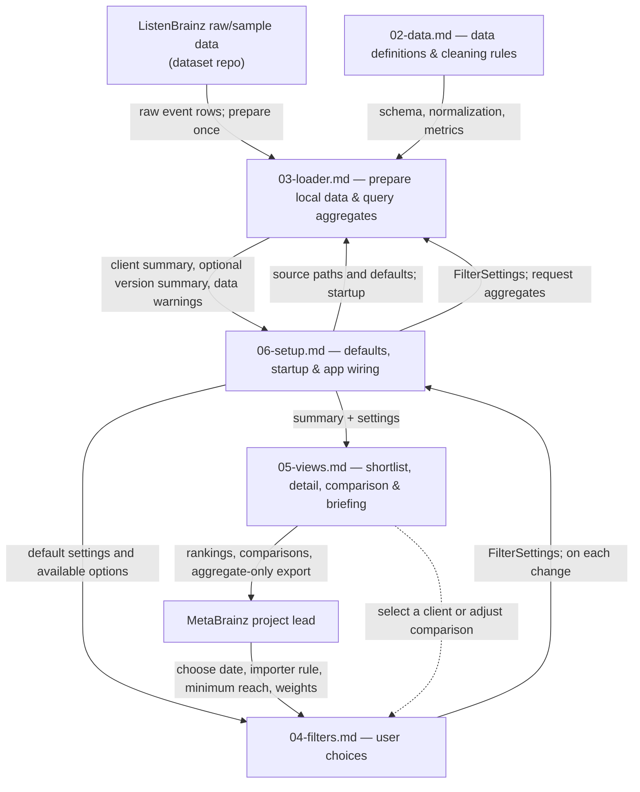

# 01 — Team Design: Client Metadata Outreach Prioritizer

**Team:** DSO-576-T5  
**Status:** Proposed architecture for the team to discuss and approve in handout 8.5.  
**Vision:** `00-vision.md` — a MetaBrainz Foundation project lead chooses which ListenBrainz submission-client maintainer to research and contact first about recording-MBID coverage.

> **Team decision still needed:** Earlier project research explored both Navidrome and MetaBrainz. This design assumes the team adopts the **MetaBrainz outreach** vision in `00-vision.md`. If not, revise this file before dividing work.

## 1. Design decisions (the four 8.4 questions)

| Question | Our proposed choice | Why it fits our project |
|---|---|---|
| **1. Clear pieces** | Five small pieces with named inputs and outputs | Each person can specify and check one part without writing one giant prompt. |
| **2. Simple connections** | Only the loader reads source data. Other pieces receive cleaned records, settings, or aggregates through explicit contracts. | Cleaning and file paths are defined once; views do not depend on dataset internals. |
| **3. Local changes** | Put definitions in `02-data.md`, defaults in `06-setup.md`, and display logic in `05-views.md`. | Changing a metric, default, or view has one clear home. |
| **4. Real-world operation** | Prepare a narrow local event dataset once; calculate selected-date aggregates on demand; return small tables to Streamlit. | The profiled daily file has ~4.4 million events and 56 columns, too large to repeatedly load into a dashboard. |

**Proposed technical approach:** Use the existing flat-file dataset, Python/pandas for validation and cleaning, a compact local Parquet file for the columns needed by our vision, **DuckDB SQL over that Parquet** for interactive counts, and Streamlit for the interface. DuckDB is a *proposed design choice*, not a tool already approved by the team. Do not require a PostgreSQL server for the local prototype. Later cloud hosting may replace local storage and caching while preserving the same piece contracts.

## 2. Architecture: one box per piece

**When each step runs**

- **Prepare once (before app startup):** Locate/unpack the permitted raw files; validate needed columns; clean and keep only necessary event fields in local Parquet. Store the observation/dump date separately from the *playback* timestamp.
- **On startup:** Load default settings, identify available data/date coverage, show the first screen (top ten eligible clients, bulk importers excluded), and load its aggregate summary.
- **On each change/click:** Requery the prepared data for the selected playback range and settings; render only aggregate results. Do **not** re-download, unpack, or clean millions of source rows after each click.

## 3. One job and contract per piece

| Piece | Its only job | Receives | Gives the next piece |
|---|---|---|---|
| **`02-data.md`** | Define source meaning, required fields, normalization and exact measures | Dataset facts and the agreed vision | Standard cleaned-event schema, definitions, and data checks for loader |
| **`03-loader.md`** | Be the **only data-file reader**; prepare data and answer queries | Source paths, data rules, user settings | Aggregated per-client table, optional per-version table, available dates, warnings |
| **`04-filters.md`** | Collect and validate user choices | Defaults, available date bounds and client choices | `FilterSettings` (date range, exclude importers, min accounts, score weight, selected clients, scenario target) |
| **`05-views.md`** | Present results and aggregate-only briefing export | `FilterSettings`, aggregate tables, warnings | Ranked shortlist, client detail, comparison, export; never raw user rows |
| **`06-setup.md`** | Start the app and connect the other pieces | Config defaults and module contracts | A working local Streamlit app with a documented run command |

**Screen on first open:** A short description of the outreach decision, filter controls, a **top-10 ranked eligible-client table**, and a warning that counts cover *observed ListenBrainz submissions*, not all users or proven client-caused gaps. Client detail and scenario comparison appear when chosen.

## 4. Shared measurement rules (final details belong in `02-data.md`)

- **One raw row:** One *submitted* listening event for one observed account. A daily dump includes historical playback submitted later; playback-date filtering must use `timestamp` / `listened_at_utc`, not the dump filename date.
- **Client:** Normalized `ai_submission_client`; blank values become `Unknown` and do not qualify for outreach ranking.
- **Recording MBID present:** `ai_recording_mbid` has a nonblank value after trimming. This measures *presence*, not verified correctness.
- **Per client:** Total listens = event rows; distinct accounts = unique `user_id`; missing-MBID listens = rows without a recording MBID; affected accounts = unique `user_id` among those rows; MBID coverage = present-MBID listens / all listens.
- **Eligible clients:** Named clients meeting the selected minimum number of observed accounts; importer exclusions apply before ranking. Confirm the team's exact importer-name matching list.
- **Score:** Use the reach-versus-missing-volume weighted percentile score from the Module 5 prototype. The precise ranking/tie rules and default weight belong in `02-data.md` and `06-setup.md`, respectively. Do not label the score a probability of a successful outreach.
- **Scenario:** The user chooses a target MBID coverage. Report the *hypothetical* additional MBID-present listens under that target, not a predicted outcome or causal impact.

**Important counting constraint:** The same account can appear on multiple dates. Do **not** add daily unique-account counts together to calculate unique accounts across a date range; count distinct accounts over the entire selected event set.

## 5. Data limitations the design must handle

- Initial sample: `dataset_listenbrainz/sample/listens_20260904.csv` (**21,276 rows, 56 columns**); the separately profiled full daily dataset has **4,411,662 submitted listens**. The team's technical notes verified archive downloads but **had not yet verified unpacked full raw files**.
- `ai_submission_client_version` is missing for most rows, so version views must disclose the known/missing version share and work when no versions are available.
- Bulk imports, client-name variations, empty MBIDs, unknown client names, and very heavy accounts can distort rankings. Define and test handling rather than silently assuming data is clean.
- A single daily submission dump does not provide a complete history of all listens *played* during the selected range. Label the observation period and data coverage clearly.
- Never display or export public user handles or event-level rows. The dataset cannot prove which client caused missing MBIDs, whether a maintainer will cooperate, or what a fix costs.

## 6. Divide the writing (proposed, based on prior team research)

The team already divided the **earlier research** as follows. These assignments are confirmed by the team member's clarification, but do **not** automatically constitute agreement on the new Module 8 pieces.

| Member | Earlier research file | Research focus | Suggested Module 8 piece | Reason |
|---|---|---|---|---|
| **Giselle** (`giselleluk`) | `objective.md` | Stakeholder decisions and project objective | `05-views.md` | Can translate the decision into what the project lead needs to see |
| **Leyna** (`leynanguyen0818`) | `alternatives.md` | Existing workflows and alternatives | `04-filters.md` | Can connect user choices and filters to the decisions made today |
| **Gigi** (`gigizhuwq`) | `data-fit.md` | Supported measures and dataset limitations | `02-data.md` | Can define and check fields, calculations, and data-quality rules |
| **Z** (`Zhongze Zhou`) | `auxiliary.md` | Missing evidence and potential additional sources | `06-setup.md` | Can specify configuration and how optional auxiliary inputs would be enabled without making them required |
| **Tinyu** (`tinyuxieUSC`) | `technical.md` | Download, file processing, storage, and tools | `03-loader.md` | Can specify preparation, data access, caching, and performance |

**These five new-piece assignments remain proposals for the team to approve in Section 8.5.** In particular, Z's original `auxiliary.md` examines the Navidrome decision; optional data relevant to the MetaBrainz outreach decision must be separately justified and verified before being required by the build. `06-setup.md` must still provide default settings and a local run path even if no auxiliary data is used.

Each teammate edits only their agreed piece, then the team combines those files into the final `one-shot-prompt.md`.

## 7. Checks before the team pushes this design

1. **Vision:** Confirm MetaBrainz (not Navidrome), and whether detail/comparison/export are in scope. Every retained view must support a use case in `00-vision.md`.
2. **Data:** Verify unpacked file locations, actual columns, sample-vs-full row counts, and the relationship between submission date and playback date.
3. **Contracts:** For each arrow, check what moves between pieces and that only `03-loader.md` accesses files.
4. **Performance:** Verify the app does not rescan/unpack raw archives per click; verify unique accounts across multiple dates are counted correctly.
5. **Ownership:** Each of the five people confirms their piece. Save and push this agreed `01-design.md` to the team's private repository before 8.6.

**Open decisions for the team:** importer-name pattern, default date range / minimum accounts / weight, score-tie handling, which source dump(s) are in scope, whether DuckDB is acceptable, and whether all four proposed use cases will be delivered. Resolve these in the assigned pieces and `06-setup.md`; do not leave them for the coding agent to guess.
