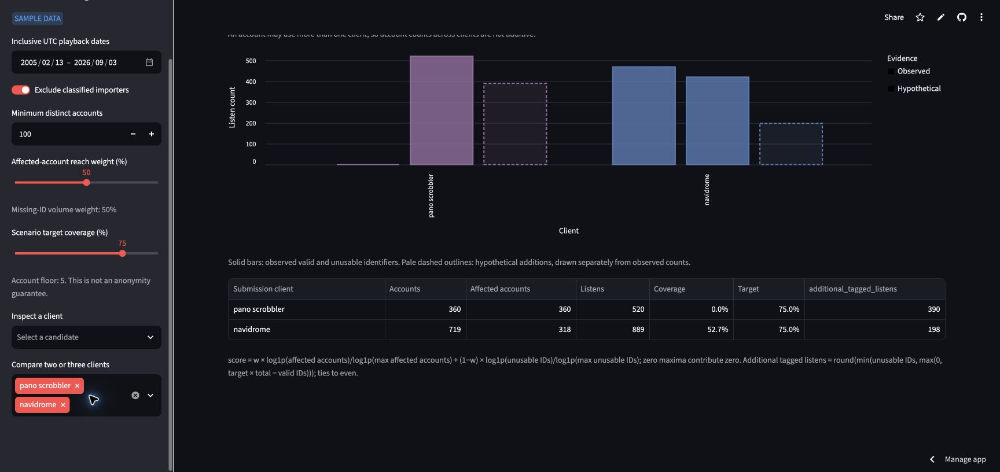
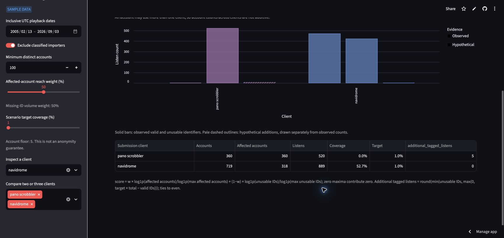
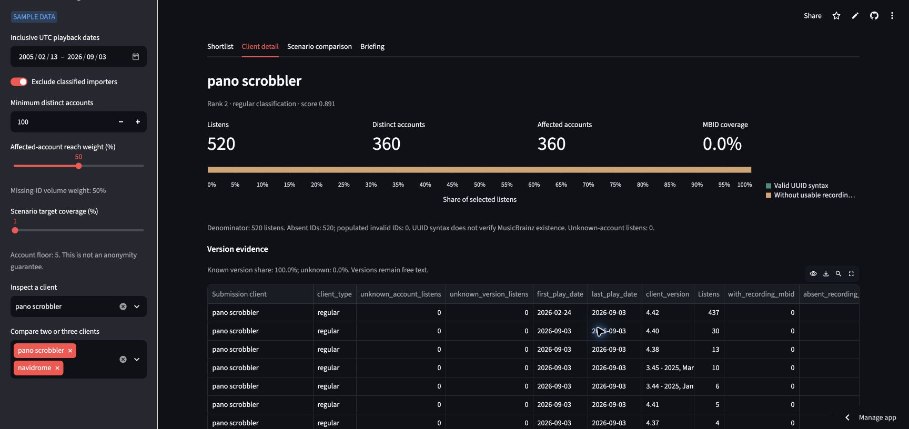
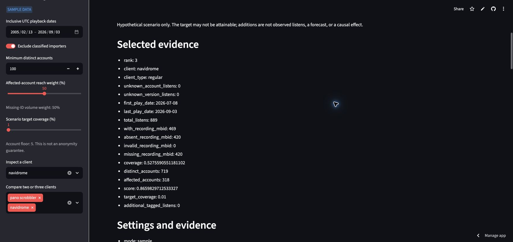

# Nora's pilot decision: can this comparison support an outreach recommendation?

**Tinyu Xie | DSO 576 | Individual case**

**Live-app evidence checked November 7, 2026.** The public app opened in a separate browser session without signing in. All screenshots are genuine captures of that public app; independent calculations use the same portable sample.

Nora should use the Client Metadata Outreach Prioritizer to identify candidates for investigation, then ask maintainers about feasibility before recommending a pilot. She should request a corrected comparison briefing before recommending Pano Scrobbler over Navidrome: the hypothetical additions do not establish deliverable impact, a small target can be missed after rounding, and the current briefing does not carry both candidates' numerical evidence together.

## 1. The person and the decision

Nora is a fictional MetaBrainz outreach coordinator preparing a two-candidate pilot recommendation. She must decide whether the app's comparison provides sufficient evidence to recommend investigating Pano Scrobbler ahead of Navidrome, or whether to return the briefing for correction. She wants an auditable recommendation that distinguishes observed identifier gaps from hypothetical improvements. A misleading recommendation could direct limited outreach effort toward an unverified opportunity or promise a milestone the displayed number does not reach. This is a scenario-comparison and briefing decision, rather than a general highest-volume-client shortlist.

## 2. Her real situation and alternatives

ListenBrainz's [JSON Documentation](https://listenbrainz.readthedocs.io/en/latest/users/json.html), published by the MetaBrainz ListenBrainz project, distinguishes client-submitted identifiers in `additional_info` from server-resolved `mbid_mapping`. It also distinguishes the submission client from the media player. These distinctions matter to Nora: missing submitted identifiers alone cannot identify which software component needs changing, and syntactically valid submitted IDs need not identify the correct recording. 

The project's [Metadata API documentation](https://listenbrainz.readthedocs.io/en/latest/users/api/metadata.html) describes lookup by artist and recording name, optionally with a release name, and manual mapping submissions. Nora therefore has alternatives to a client outreach pilot: evaluate matching or mapping workflows, inspect example submissions, and discuss the submission path with maintainers. 

**Sources and supporting passages, read November 7, 2026:**

- MetaBrainz ListenBrainz, [JSON Documentation](https://listenbrainz.readthedocs.io/en/latest/users/json.html), “How mbid_mapping differs from additional_info” and “Client Metadata examples”: client-supplied IDs can be incorrect; the submission client and player can be different programs.
- MetaBrainz ListenBrainz, [Metadata API](https://listenbrainz.readthedocs.io/en/latest/users/api/metadata.html), “GET /1/metadata/lookup/” and “POST /1/metadata/submit_manual_mapping/”: documents text-based lookup and manual recording mapping.
- USC DSO 576, [How these samples were cut](https://github.com/USC-DSO-576-PS/dataset_listenbrainz/blob/main/sample/README.md): describes uniform random sampling and explains why a submission-day dump includes historical playback dates. This supports the sample-scope limitation below.

## 3. The app in use

**Live app:** [Client Metadata Outreach Prioritizer](https://appapppy-mdilrzqijilc29whq52tc2.streamlit.app/). Public deployment: team repository, branch `case-live-evidence`, entry point `streamlit_app.py`. The hosted sample retains every source sample event and the measurement fields, omits unused columns and user names, and consistently replaces account numbers. It is not full-population data.

Use sample mode; inclusive UTC playback dates **2005-02-13 through 2026-09-03**; exclude classified importers; minimum distinct accounts **100**; affected-account reach weight **50%**. In the comparison selector choose **navidrome** and **pano scrobbler**. First set scenario target coverage to **75%**; then test **1%**. Inspect Pano Scrobbler in Client detail. Finally open Briefing with Navidrome inspected while both comparison clients remain selected.

| Independently verified sample measure | Navidrome | Pano Scrobbler |
|---|---:|---:|
| Observed listens | 889 | 520 |
| Listens with a syntactically valid recording MBID | 469 | 0 |
| Submitted-MBID coverage | 52.7559% | 0% |
| Observed distinct accounts | 719 | 360 |
| Accounts with at least one unusable-ID listen | 318 | 360 |
| Hypothetical additions at a 75% target | 198 | 390 |
| Hypothetical additions at a 1% target | 0 | 5 |

The underlying portable sample contains **21,276 events**. An independent CSV counter agrees with the application's totals, valid/absent/invalid-ID counts, distinct accounts, affected accounts, and coverage for every one of the **five eligible clients** under these settings. Account counts across clients must not be added because a person may submit through more than one client.

**Live observations:** Screenshot A shows 390 additions for Pano and 198 for Navidrome at 75%. Screenshot B shows 5 and 0 at 1%. Screenshot C verifies Pano's denominator: 520 listens, 360 distinct and affected accounts, 520 absent IDs, and no populated-invalid IDs. Screenshot D shows only Navidrome's numerical evidence in Briefing even though both comparison clients remain selected. The table formats Navidrome's coverage as 52.7%; the precise count-based value is 469/889 = 52.7559%. The screenshots and enlarged evidence crops follow the memo.

## 4. Reading the result for her decision

**Does the number measure what Nora cares about?** Partly. The comparison measures the observed gap in submitted IDs and a hypothetical count needed to approach a selected coverage target. Nora needs evidence that a feasible pilot would improve identification. Those are different questions: kind 3, **the real thing or a stand-in**. UUID syntax is a proxy for usable identification, not a check that the ID exists or names the right recording. Missing submission IDs also do not measure missing server matches, which the official JSON documentation describes separately.

There is also a precise mismatch between an approximate rounded count and a minimum-to-reach target. `outreach/filters.py`, function `estimate_scenarios`, calculates `round(min(unusable, max(0, target * total - valid)))`. For Pano at 1%, the unrounded gap is `0.01 * 520 - 0 = 5.2`; the function returns 5. Achieved coverage would be `5 / 520 * 100 = 0.961538%`. An exhaustive integer search returns 6 as the smallest count reaching at least 1%; `6 / 520 * 100 = 1.153846%`. The app follows its documented rounding formula, but that output cannot be read as a guaranteed threshold. The arithmetic is exact for these sample counts; it is not a forecast.

**Who is in the rows, and who is not?** One source row is a sampled submitted listen, not a unique listener, song, installed client, or maintainer. The app groups accepted rows by playback date, client, version, and internal account key before computing aggregates. The displayed comparison includes named clients that meet the selected account threshold, after classified-importer exclusion and playback-date filtering. Missing client labels and low-reach clients do not appear as eligible comparison candidates. Unknown classifications can remain; importer exclusion is not proof that all historical imports have disappeared. Events without valid accounts can contribute listens but do not contribute distinct-account reach. Users outside this submitted sample and current installations are not counted. This is kind 6, **share of whom**, and kind 5, **which dates belong**: the denominator is selected sample listens, while dates describe playback, not a current active-user census.

**What outside the data matters?** Nora must establish which component supplies recording IDs, whether metadata can be recovered by mapping, whether a maintainer is active and willing to help, and what effort and benefit a pilot would involve. The public documentation establishes that multiple submission and mapping paths exist; this dataset does not establish feasibility, willingness, costs, or causation. She should check current release and issue information and ask maintainers before treating hypothetical gains as a commitment. No such conversations have been conducted for this case.

**What could she wrongly conclude?** “Pano has 390 additions at 75%, so contacting its maintainer will create more usable listens than contacting Navidrome” confuses a target-driven scenario with an intervention effect. The clients also start at different coverage levels. “Five fixes achieve 1%” fails the explicit calculation above. Finally, sharing a single-client briefing as if it documented a two-client comparison would omit the competing candidate's numerical evidence. `outreach/views.py`, function `briefing`, filters scenario rows to the inspected client; the comparison-client names in settings do not make those omitted result rows appear.

**Reproducible check:** From the team repository root, after installing app requirements, run `python scripts/check_case.py`. It prepares the portable sample, independently counts the CSV with Python counters and sets, compares the results with the application, and searches integer additions from zero upward. Output is saved as `cases/tinyu/calculation-evidence.json`. The executed result was `independent_aggregate_check: PASS`; Pano at 1% returned `app_additions: 5`, `minimum_to_reach: 6`, and `achieved_coverage: 0.009615384615384616` (a fraction).

## 5. The verdict: prove or break

**Break the app's readiness to support this recommendation; retain it as a screening aid.** Nora is better off using the app to compare observed identifier gaps than grouping raw exports manually, because it makes reach, baseline coverage, and hypothetical changes available together. It is not sufficient evidence to prefer a feasible Pano intervention over Navidrome, nor to promise a 1% milestone. She should return the briefing for correction and investigate submission and mapping paths before choosing an outreach partner. 

The following requests are the existing team requests **CR-03 and CR-04**, originated by Tinyu Xie; they are not new duplicate requests. Their numerical basis has been rechecked here. Both behaviors were confirmed on the public app at the settings above.

**CR-03 - Show achieved coverage and the minimum additions needed to reach the target.** Part: Scenario comparison. Evidence: Pano, 520 listens, zero valid submitted IDs, 1% target; five rounded additions reach 0.9615%, while six reach at least 1%. Change: preserve the existing approximate scenario number, add its achieved coverage, and separately label the minimum-to-reach count. Priority: medium. Status: open. Acceptance: a regression check distinguishes 5 approximate additions, 0.9615% achieved coverage, and 6 minimum additions; zero and already-met targets return zero. Keep every scenario hypothetical; retain both meanings for all client sizes. 

**CR-04 - Export the complete selected scenario comparison.** Part: Comparison-to-briefing workflow. Evidence: with Navidrome and Pano selected, the reviewed `briefing` code retains only the inspected client's scenario row. Change: add a complete comparison CSV and Markdown briefing for all selected candidates, including observed totals and coverage, target, additions, source and mode, playback dates, filters, formula, hypothetical-scenario warning, and the warning that account counts are not additive. Preserve the existing individual-client briefing for users needing one candidate. Priority: medium. Status: open. Acceptance: selecting the two clients produces two numerical comparison rows at the same settings and retains reproducibility information. 

## Live-app evidence for Part 3

All four screenshots were captured at the public link above on November 7, 2026. Common settings: sample mode; inclusive UTC playback dates 2005-02-13 through 2026-09-03; importer exclusion on; minimum accounts 100; reach weight 50%; comparison clients pano scrobbler and navidrome.

**A. Scenario comparison at 75%.** Pano: 390 hypothetical additions. Navidrome: 198. These are hypothetical target calculations, not predicted effects of outreach.

**B. Scenario comparison at 1%.** Pano: 5 approximate additions; Navidrome: 0 because its observed coverage already exceeds the target. Five out of 520 is below 1%; six would be required to reach at least 1%.

**C. Pano Client detail at the same 1% scenario setting.** The observed denominator and submitted-ID status are visible. The version table continues below the crop; no claim relies on the omitted rows.

**D. Briefing at 1%, inspecting Navidrome while both candidates remain selected.** The complete selected-evidence block contains Navidrome alone and is followed immediately by Settings and evidence. This supports CR-04; naming both clients in the selector does not supply both numerical result rows.

