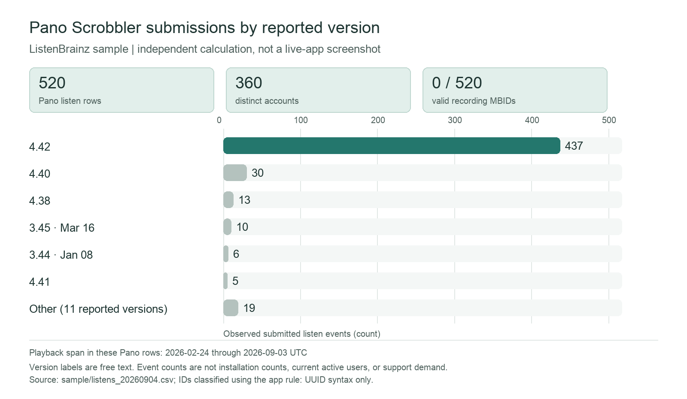

# Should Morgan keep compatibility support for an older Pano Scrobbler version?

**Leyna Nguyen | DSO 576 | Individual case | November 8, 2026**

> **Recommendation:** Use the Client Metadata Outreach Prioritizer to decide which Pano version to investigate first. Do not use its ListenBrainz counts alone to decide whether to keep or drop compatibility support. The sample does not measure active installations, support requests, reproducible failures, or maintenance cost.

## 1. The person and the decision

Morgan is a fictional Pano Scrobbler maintainer reviewing limited debugging and compatibility time. Morgan must decide whether version-level ListenBrainz evidence is enough to investigate support needs for an older Pano release before deciding how much support work to keep investing in it. A poor choice could leave an actual problem unresolved or spend effort based on a version count that does not reflect current users or support demand.

## 2. Morgan's situation and alternatives

Pano's official release notes attach changes and fixes to numbered versions. Its issue tracker also contains a historical version-specific report: a user said AutoShazam detections stopped scrobbling after updating to 3.38 and that 3.37 worked. The maintainer discussed a fix; a later commenter reported the problem on 3.39. That thread shows why reproducing an issue across versions can matter. It does not establish a current compatibility problem or the support needs of older versions. [Pano Scrobbler releases](https://github.com/kawaiiDango/pano-scrobbler/releases), [version 3.38 issue](https://github.com/kawaiiDango/pano-scrobbler/issues/488).

ListenBrainz defines `submission_client_version` as the version of the software submitting a listen. That makes the field relevant as a possible usage signal. Morgan can also inspect release notes and issues, review support messages and crash logs, reproduce a problem on the affected build and operating system, and ask users whether they can upgrade. Those sources can speak to failure and support burden; the app cannot. [ListenBrainz JSON Documentation](https://listenbrainz.readthedocs.io/en/latest/users/json.html).

## 3. The app in use

**Live app:** [Client Metadata Outreach Prioritizer](https://appapppy-mdilrzqijilc29whq52tc2.streamlit.app/). Morgan would select `pano scrobbler` in client detail, record the playback dates and filters, and review the version table and weekly playback evidence.

**Evidence access note:** On November 8, 2026, an unauthenticated request to the public URL redirected to Streamlit authentication. I could not verify live deployment selections or capture its screen. The repository configuration defaults to sample mode, observed playback-date bounds, importer exclusion, a 100-account minimum, a 50% reach weight, and a 75% scenario target; deployment settings were not verified.

**Sample-data evidence:** I independently grouped the supplied `sample/listens_20260904.csv` using the app's client-name, playback-timestamp, version-label, and UUID-syntax rules. The sample contains 520 Pano listen events from 360 distinct accounts across 17 reported version labels. All 520 lack a recording MBID; none has a syntactically valid or populated-invalid ID. These are sample calculations, not values verified in a live session.

The largest group is version 4.42, with 437 of the 520 Pano sample events. Version strings are free text, so they are not guaranteed to be standardized software releases. Event counts are not installation counts or support cases. The live-app screenshot is still not included; the public app redirected to authentication during this check.

## 4. Reading the result

**Does the number measure what Morgan cares about?** Only partly. ListenBrainz listens grouped by reported Pano version show submissions in this sample with that version label. The sample has 520 Pano events from 360 accounts; version 4.42 accounts for 437 events. All 520 lack a syntactically valid recording MBID, but that measures submitted identifier data, not whether Pano itself is compatible. The data do not count active installations, support incidents, reproducible failures, engineering effort, or users unable to upgrade. Version traffic can help Morgan choose what to investigate; by itself it cannot decide what to support.

**Who is in the rows, and who is not?** A source row is one accepted listen submission, not a unique installation, user, bug, or support request. These Pano rows span playback dates 2026-02-24 through 2026-09-03 UTC. Selected dates and importer settings filter rows; events without valid account keys can add listens but not distinct-account counts. The app says observed ListenBrainz submissions are an incomplete sample of playback history and client users. Pano users who do not submit to ListenBrainz, support cases, and listens with unknown or inconsistent version labels are not represented by the version counts.

**What outside the data matters?** Release notes and issue reports, current support messages and crash logs, operating-system versions, reproducible tests on older builds, upgrade availability, and the maintainer's time. The official issue thread is one historical example of a version-specific report; it is not evidence of current demand.

**What could Morgan wrongly conclude?** A small observed count does not prove nobody needs an older version; a large count does not prove the version is defective or expensive to support. The 437 events labeled 4.42 are listens, not 437 installations. The sample is incomplete and contains no measure of support workload or compatibility cause. Morgan should review current reports and reproduce a concrete issue before changing the support plan.

## 5. Verdict

**Break for the support-retention decision; keep the app as an investigation aid.** The app can narrow which reported Pano version to inspect more efficiently than manually grouping ListenBrainz exports. Morgan should not use its version counts as a census, support-ticket total, or proof that a release is healthy or defective. No new change request is proposed: the missing evidence is support and installation data that this dataset does not contain. Existing team requests CR-05 and CR-06 address version-gap ranking and metric context, but do not measure support demand.
