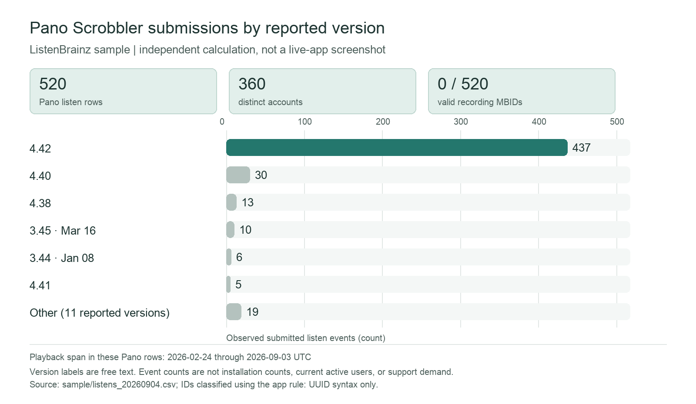

# Case: Morgan, a Pano Scrobbler maintainer, and older-version compatibility

> Working file. The first idea, investigating Navidrome versions, was withdrawn after comparing it with Zhongze's case on `case-live-evidence`, which makes the same version-priority decision for Navidrome. This case asks a different question about Pano: whether observed version traffic justifies investigation before deciding how much compatibility work to do. The final memo is in `leyna-pano-version-support-final.md`.

## 1. The person and the decision

Morgan is a fictional Pano Scrobbler maintainer reviewing where to spend limited compatibility and debugging time. Morgan must decide whether the app's version-level ListenBrainz evidence is enough to investigate support needs for an older Pano release before deciding whether to keep devoting support work to it. A poor decision could leave a real compatibility problem unexplored or spend effort on a version whose observed traffic does not reflect current users or support demand.

## 2. Morgan's real situation and alternatives

Pano's official release notes show changes and fixes attached to numbered releases, while its public issue tracker records version-specific reports. In one report, a user said AutoShazam detections stopped scrobbling after Pano updated to 3.38, and that 3.37 still worked. The maintainer replied that a fix would come in the next update; a later comment in that issue said the problem continued on 3.39. This historical thread shows why a developer may investigate behavior across versions. It does not show that an older Pano release currently needs support or that ListenBrainz traffic measures the support burden.

ListenBrainz defines `submission_client_version` as the version of the software submitting a listen. Version-level submissions therefore provide a possible usage signal. Morgan's alternatives are to inspect release notes and issue reports, reproduce the behavior on the relevant Pano build and operating system, review current support requests and logs, and ask affected users for details. The app summarizes observed submissions but cannot replace these checks.

**Sources:**

- [Pano Scrobbler releases](https://github.com/kawaiiDango/pano-scrobbler/releases), Pano Scrobbler's official GitHub repository: versioned release notes list fixes and behavior changes.
- [Version 3.38 not scrobbling from Shazam](https://github.com/kawaiiDango/pano-scrobbler/issues/488), Pano Scrobbler's official issue tracker: a user reported an AutoShazam scrobbling problem after updating to 3.38 and said 3.37 worked; the maintainer discussed a fix, and a later commenter reported the problem on 3.39.
- [JSON Documentation](https://listenbrainz.readthedocs.io/en/latest/users/json.html), ListenBrainz documentation: defines `submission_client_version` as the submitting client's version and distinguishes IDs supplied by a client from server-resolved mappings.

## 3. The app in use

**Live link:** [Client Metadata Outreach Prioritizer](https://appapppy-mdilrzqijilc29whq52tc2.streamlit.app/).

**What Morgan would select:** The repository defaults specify sample mode, inclusive observed playback bounds, classified-importer exclusion, a 100-account minimum, and `pano scrobbler` in client detail. These settings describe the checked-in config, not a verified live session.



The checked-in `outreach-app/config.toml` also defaults to a 50% reach weight and a 75% scenario target; neither is used in this version-count figure. A direct unauthenticated request to the public URL redirected to Streamlit authentication, so I could not inspect live settings or capture the app. The figure is a calculation from the provided sample CSV, not a screenshot.

**What the app shows:** The client-detail code displays aggregate listens, distinct and affected accounts, recording-MBID coverage, version evidence, weekly playback evidence, and ranking sensitivity. Version labels remain free text, with the known-version share displayed. Weekly evidence uses UTC weeks and marks partial edge weeks. These measures describe selected ListenBrainz submissions, not all Pano installations, support requests, or compatibility costs.

## 4. Reading the result for Morgan's decision

**Does the number measure what Morgan cares about?** Only partly. The sample contains 520 Pano listen events from 360 distinct accounts across 17 reported version labels; every one of those 520 events lacks a recording MBID under the app's UUID-syntax rule. The largest version group is 4.42 with 437 events. This is a signal of observed submissions in this sample, not a measure of whether Pano itself works or whether an older build deserves ongoing support. The data do not count active installations, support incidents, reproducible failures, engineering effort, or users unable to upgrade. I would use version traffic to choose what to investigate, not as the support decision itself.

**Who is in the rows, and who is not?** Each source row is one accepted listen submission. The sample CSV has 21,276 event rows; 520 are labeled `Pano Scrobbler`, with Pano playback dates from 2026-02-24 through 2026-09-03 UTC. The query uses the selected inclusive playback dates and excludes clients classified as importers. Distinct-account metrics cannot include events without a valid account key. The app says observed ListenBrainz submissions are an incomplete sample of playback history and client users. Pano users who do not submit to ListenBrainz, support cases, installations, and unreported or inconsistent version labels are not represented by these counts.

**What outside the data matters?** Release notes, open issues, support messages, crash logs, operating-system versions, reproducible tests on older Pano builds, whether users can upgrade, and the maintainer's available time. The official issue thread illustrates the value of version-specific reproduction; it does not establish current support needs for Pano.

**What could Morgan wrongly conclude?** Morgan could treat a smaller observed count for an older version as proof that nobody needs it, or the 437 submissions labeled 4.42 as proof that older versions can be dropped. Neither follows: event counts are not installation counts, the sample is incomplete, and it contains neither support workload nor evidence of a compatibility defect. Morgan should check current reports and reproduce a concrete issue before changing support policy.

**Reproducible check:** The chart was calculated from `../../dataset_listenbrainz/sample/listens_20260904.csv` with the app's client normalization, timestamp-to-UTC playback date, version trimming, UUID-syntax ID rule, and account deduplication. The sample defaults exclude classified importers; Pano is classified as a regular client. This independent calculation is not a live-app screenshot.

```text
Sample source rows: 21276
Pano listen rows: 520
Pano distinct accounts: 360
Reported version labels: 17
Pano playback span: 2026-02-24 through 2026-09-03 UTC
valid recording MBID syntax: 0
absent recording MBID syntax: 520
invalid recording MBID syntax: 0
Largest version groups:
  4.42: 437
  4.40: 30
  4.38: 13
  3.45 - 2025, Mar 16: 10
  3.44 - 2025, Jan 08: 6
  4.41: 5
  Other (11 reported version labels): 19
```

The reproducible script is [`scripts/check_pano_sample.py`](scripts/check_pano_sample.py). The app's calculation sources are `outreach-app/outreach/data_rules.py`, `outreach-app/outreach/loader.py`, and `outreach-app/outreach/views.py`. The cleaner creates one listen count per accepted event and applies the UUID syntax rule; the loader groups by submitted version text; the detail view labels those strings as free text.

## 5. The verdict: prove or break

**Break for a support-retention decision; keep as an investigation aid.** Morgan is better off using the version breakdown to identify which reported Pano versions appear in the sample than manually grouping the export. The distribution is heavily concentrated in version 4.42, but that does not show whether users of older versions need support. Morgan is not better off using the app alone to decide whether to keep or drop compatibility work. The app cannot measure support burden or consequences for users absent from ListenBrainz. Morgan must not treat version traffic as an installation census, support-ticket count, or proof that a version is healthy or defective.

No new change request is proposed: the missing evidence is support and installation data, which this ListenBrainz dataset does not contain. The team's existing CR-05 and CR-06 address version-gap ranking and metric context; neither would turn sampled listens into support-demand evidence. The figure is independently calculated from the sample and is not a capture of the public app.
