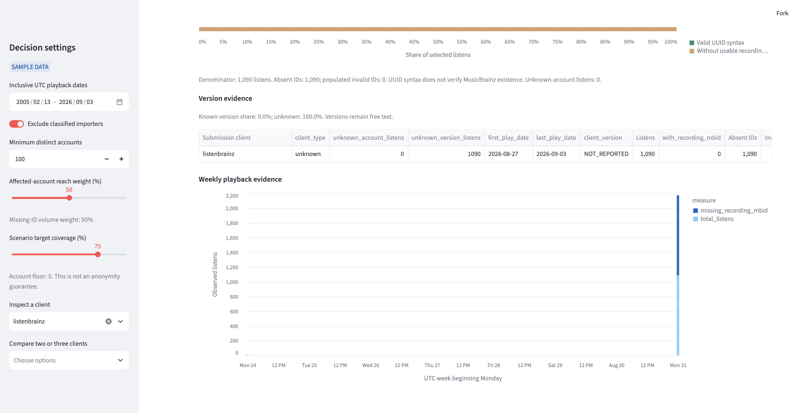

# Rachel and the `listenbrainz` outreach decision

> **Bottom line:** Rachel should use the app to investigate `listenbrainz`, but should hold it
> for classification and ownership verification before adding it to the outreach candidate list.
> The app's rank is a useful screening signal, not proof that the label identifies a contactable
> client maintainer or an eligible outreach target.

## 1. The person and the decision

Rachel is a fictional ListenBrainz integration coordinator who maintains a list of submission
clients that the MetaBrainz Foundation may investigate and contact. When a client appears at the
top of the shortlist, Rachel must decide whether to add it to the outreach candidate list now or
hold it for classification verification first. A poor decision could send outreach toward an
unverified label or cause Rachel to overlook a real client that needs better recording metadata.

Her case is the client label `listenbrainz`, which ranks first with score 1.000 but is marked
`unknown` by the app.

## 2. Rachel's situation and alternatives

ListenBrainz's [official JSON documentation](https://listenbrainz.readthedocs.io/en/latest/users/json.html)
defines `submission_client` as the client used to submit a listen and
`submission_client_version` as that client's version. It also defines
`original_submission_client` as the first client when another tool later imports a listen and
notes that this field is useful for importers. These fields make the observed label useful for
investigation, but they do not establish an owner, maintainer, or outreach eligibility.

The [official ListenBrainz Core API documentation](https://listenbrainz.readthedocs.io/en/latest/users/api/core.html)
describes submission through `submit-listens` and distinguishes ordinary submissions from
`import` submissions. Rachel should therefore verify the submission context and metadata before
interpreting an aggregate label as a direct-client population.

Rachel's alternatives are to inspect the exact label in the ListenBrainz/MetaBrainz code and issue
tracker, search for a repository owner or client documentation, ask the ListenBrainz community,
and use current support or maintainer evidence. The [MetaBrainz ListenBrainz server repository](https://github.com/metabrainz/listenbrainz-server)
directs contributors to its issue tracker and IRC/Matrix/Discord community, giving Rachel public
routes for verification and contact.

The app does not contain a verified ownership directory, an importer/first-party provenance
field, current maintainer activity, support demand, or a causal test showing that the client
caused missing recording MBIDs. Those facts matter to Rachel's decision but must come from
outside the sample.

## 3. The app in use

Rachel uses the [Client Metadata Outreach Prioritizer](https://appapppy-mdilrzqijilc29whq52tc2.streamlit.app/)
in Sample Data mode. The relevant settings are:

- playback dates: `2005-02-13` through `2026-09-03` UTC;
- classified-importer exclusion: on;
- minimum distinct accounts: `100`;
- affected-account reach weight: `50%`;
- scenario target: `75%`.

She inspects `listenbrainz` on the Shortlist and then selects it in Client detail.




The live screenshots show 1,090 observed listens, 765 distinct accounts, 765 affected accounts,
1,090 unusable recording MBIDs, 0 valid recording MBIDs, and 0.0% coverage. They also show rank
1, score 1.000, and classification `unknown`. The evidence view shows that all 1,090 listens have
an unreported version and that the selected client's observed playback dates are 2026-08-27
through 2026-09-03 within the broader sample range.

## 4. Reading the result for Rachel's decision

### Does the number measure what Rachel cares about?

Only partly. The score measures the size of the observed `listenbrainz` aggregate relative to the
other rows on two screening inputs: affected accounts and listens without a usable recording
MBID. It does not measure whether `listenbrainz` is a standalone submission client, who maintains
it, whether it is an importer, or whether anyone is available to contact.

The code confirms this distinction. `rank_clients` computes the score from
`affected_accounts` and `missing_recording_mbid`. Separately, `clean_event` assigns a client type
from exact configured importer and regular-client lists. Ranking and outreach eligibility are
therefore not the same decision.

### Who is in the rows, and who is not?

Each row represents one accepted ListenBrainz submission event. In the sample, the
`listenbrainz` aggregate represents 1,090 events from 765 observed accounts across the selected
playback dates—not 765 installations, maintainers, organizations, or outreach requests. Rows
without valid positive account identifiers can contribute listens but not distinct-account counts.

The data leave out people who did not submit to ListenBrainz, support reports, inactive
installations, ownership information, and a reliable distinction between a direct client and an
importer unless metadata and classification rules provide it.

### What outside the data matters?

Rachel needs a verified client identity and contact route, the tool's repository or documentation,
evidence about first-party versus import provenance, current maintainer activity, and evidence
that better recording-MBID coverage is a meaningful outreach issue. The ListenBrainz documentation
shows why original-submission provenance can matter, while the MetaBrainz repository identifies
public issue and community channels where Rachel can verify the label.

### What could Rachel wrongly conclude?

Rachel could read rank 1 and score 1.000 as proof that `listenbrainz` is the highest-priority
outreach client and immediately add it to the candidate list. That conclusion is too strong. The
score establishes only that this exact label has the largest observed aggregate under the chosen
filters. `unknown` does not mean importer, and it does not mean regular client; it means the label
is in neither configured list. Rachel should hold the label for classification and ownership
verification while retaining the ranking as an investigation signal.

### Independent calculation

I independently read `dataset_listenbrainz/sample/listens_20260904.csv`, trimmed and case-folded
client labels, counted event rows, counted distinct positive `user_id` values, counted affected
accounts among rows without a syntactically valid UUID recording MBID, and applied the formula in
`outreach/filters.py`.

```text
listenbrainz listens 1090 accounts 765 affected 765 valid 0 missing 1090 type unknown
navidrome listens 889 accounts 719 affected 318 valid 469 missing 420 type regular
pano scrobbler listens 520 accounts 360 affected 360 valid 0 missing 520 type regular
web scrobbler listens 317 accounts 166 affected 166 valid 0 missing 317 type regular
listenbrainz android listens 305 accounts 211 affected 211 valid 0 missing 305 type regular
roon listens 86 accounts 63 affected 63 valid 0 missing 86 type regular
```

After importer exclusion and the 100-account floor, `listenbrainz` is the maximum on both
ranking inputs: 765 affected accounts and 1,090 unusable IDs. At reach weight 0.5, both
log-normalized terms equal 1, so its score is `0.5 × 1 + 0.5 × 1 = 1.000`.

## 5. Verdict

**Break for immediate outreach eligibility; keep as an investigation aid.** The app is useful
because it surfaces `listenbrainz` quickly: its observed volume and affected-account reach are
large. It is not sufficient evidence to place the label directly on Rachel's outreach candidate
list because the app has no verified classification or maintainer identity. Rachel is better off
using the app to prioritize a verification step, then using source repositories, issue trackers,
documentation, and community channels to decide whether outreach is appropriate.

### Proposed change request

**CR-09: Separate screening rank from verified outreach eligibility**

- **From:** Rachel case, 2026-11-08
- **Part:** Shortlist eligibility and client classification
- **Evidence:** In Sample Data mode with playback dates `2005-02-13` through `2026-09-03`, classified-importer exclusion on, minimum accounts `100`, and reach weight `50%`, the independent sample calculation gives `listenbrainz` 1,090 listens, 765 distinct accounts, 765 affected accounts, 1,090 unusable IDs, and score `1.000`. The configuration lists exact importer and regular-client names; `listenbrainz` is in neither list and is therefore classified `unknown`. The loader excludes only `NOT_REPORTED` and clients below the account floor before ranking; `rank_clients` does not require `client_type == "regular"`.
- **Change:** Keep unknown labels visible as investigation leads, but add a clearly separate outreach-eligibility status or filter that requires verified classification and ownership. Label the current rank as screening priority and do not imply that rank alone makes an unknown client an outreach candidate.
- **Priority:** medium
- **Status:** open
