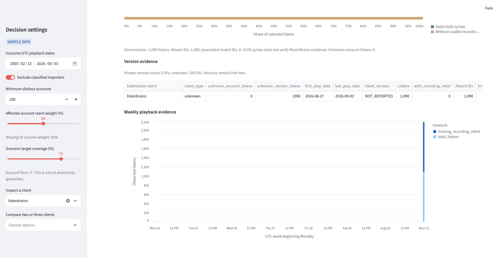

# Working case: Rachel, the `listenbrainz` classification decision

> **Working draft — November 8, 2026.** The live-app screenshots are still pending because the
> deployed URL was inaccessible from this environment. The local sample calculations below are
> reproducible evidence, not a substitute for live-app screenshots.

## 1. The person and the decision

Rachel is a fictional ListenBrainz integration coordinator who maintains a list of submission
clients that the MetaBrainz Foundation may investigate and contact. When a client appears at the
top of the shortlist, Rachel must decide whether to add it to the outreach candidate list now or
hold it for classification verification first. The decision matters because a high ranking can
reflect observed volume and missing recording identifiers without proving that the label names a
contactable client maintainer rather than an internal, generic, or otherwise unverified submitter.

Rachel's specific case is the client label `listenbrainz`, which ranks first with score 1.000 but
is marked `unknown` by the app.

## 2. Rachel's real situation and alternatives

ListenBrainz's official JSON documentation defines `submission_client` as the name of the client
used to submit a listen and defines `submission_client_version` as that client's version. It also
specifies `original_submission_client` as the first client when another tool later imports the
listen, explicitly noting that this field is useful for importers. These fields make the observed
label relevant to Rachel's investigation, but they do not by themselves establish an owner,
maintainer, or outreach eligibility: [ListenBrainz JSON Documentation](https://listenbrainz.readthedocs.io/en/latest/users/json.html).

The official ListenBrainz API documentation describes listen submission through the
`submit-listens` endpoint and distinguishes ordinary submissions from `import` submissions. That
supports checking the submission path and metadata before treating an aggregate label as a
direct-client population: [ListenBrainz Core API](https://listenbrainz.readthedocs.io/en/latest/users/api/core.html).

For outreach, Rachel's alternatives are to inspect the ListenBrainz/MetaBrainz code and issue
tracker, search for an exact client or repository owner, ask the ListenBrainz community, and
cross-check the label against client documentation or a maintainer's repository. The official
ListenBrainz server repository points contributors to its issue tracker and IRC/Matrix/Discord
community, which are practical verification and contact routes: [MetaBrainz ListenBrainz server](https://github.com/metabrainz/listenbrainz-server).

The app does not contain a verified ownership directory, an importer/first-party provenance
field, current maintainer activity, support demand, or a causal test showing that the client
caused missing recording MBIDs. Rachel therefore needs classification and ownership evidence
outside the sample before treating `listenbrainz` as an outreach candidate.

## 3. The app in use

**Live link:** [Client Metadata Outreach Prioritizer](https://appapppy-mdilrzqijilc29whq52tc2.streamlit.app/)

**Selections for Rachel:** Use Sample Data mode. Leave the observed playback range at
`2005-02-13` through `2026-09-03` UTC, keep **Exclude classified importers** on, set **Minimum
distinct accounts** to `100`, leave **Affected-account reach weight** at `50%`, and leave the
scenario target at `75%`. On the Shortlist tab, inspect `listenbrainz`; then select it in the
client-detail control.

**Required genuine live screenshots:**




**What the local sample calculation predicts the live view should show:** `listenbrainz` has
1,090 observed listens, 765 distinct accounts, 765 affected accounts, 1,090 unusable recording
MBIDs, 0 valid recording MBIDs, and 0.0% coverage. It is classified `unknown`, ranks first, and
has score `1.000` at the 50% reach weight. These values must be checked against the live screen
and updated if the deployed app differs.

### Reproducible local check

I independently read `dataset_listenbrainz/sample/listens_20260904.csv`, normalized client labels
by trimming and case-folding, counted event rows, counted distinct positive `user_id` values,
counted affected accounts among rows without a syntactically valid UUID recording MBID, and
applied the ranking formula in `outreach/filters.py`. The relevant output was:

```text
date bounds 2005-02-13 2026-09-03
listenbrainz listens 1090 accounts 765 affected 765 valid 0 missing 1090 versions 1 type unknown
navidrome listens 889 accounts 719 affected 318 valid 469 missing 420 versions 42 type regular
pano scrobbler listens 520 accounts 360 affected 360 valid 0 missing 520 versions 17 type regular
web scrobbler listens 317 accounts 166 affected 166 valid 0 missing 317 versions 4 type regular
listenbrainz android listens 305 accounts 211 affected 211 valid 0 missing 305 versions 3 type regular
roon listens 86 accounts 63 affected 63 valid 0 missing 86 versions 5 type regular
```

After excluding the configured importer labels and applying the 100-account floor, the ranked
rows included:

```text
client                    type       listens  accounts  affected  missing  score
listenbrainz              unknown       1090       765       765     1090  1.000000
pano scrobbler            regular        520       360       360      520  0.890529
navidrome                 regular        889       719       318      420  0.865983
unknown                   unknown        847       130       107      814  0.831659
listenbrainz android      regular        305       211       211      305  0.812414
web scrobbler             regular        317       166       166      317  0.797201
```

The score is 1.000 because `listenbrainz` is the maximum on both ranking inputs: affected
accounts and unusable-ID listens. The formula is a weighted sum of log-normalized affected
accounts and log-normalized unusable IDs; at weight 0.5, both normalized terms equal 1.

## 4. Reading the result for Rachel's decision

**Does the number measure what Rachel cares about?** Only partly. The score measures how large
the observed `listenbrainz` aggregate is relative to the other eligible rows on two screening
inputs. It does not measure whether `listenbrainz` is a real standalone submission client, who
maintains it, whether it is an importer, or whether anyone is available to contact. The code
confirms the distinction: `rank_clients` calculates the score from `affected_accounts` and
`missing_recording_mbid`, while `clean_event` assigns `client_type` from exact configured name
lists.

**Who is in the rows, and who is not?** Each row is one accepted ListenBrainz submission event.
The sample's `listenbrainz` row represents 1,090 events from 765 observed accounts across the
sample playback dates, not 765 installations, maintainers, organizations, or outreach requests.
Rows without valid positive account identifiers can contribute listens but not distinct-account
counts. The dataset also leaves out people who did not submit to ListenBrainz, support reports,
inactive installations, ownership information, and any reliable distinction between a direct
client and an importer unless the metadata and classification rules provide it.

**What outside the data matters to this decision?** Rachel needs a verified client identity and
contact route, the tool's repository or documentation, whether the label is first-party or
import-related, current maintainer activity, and evidence that better recording-MBID coverage is
a meaningful outreach issue. The ListenBrainz documentation's `original_submission_client` field
shows why importer provenance can matter, while the MetaBrainz repository's issue/community links
show where Rachel could verify ownership and contact routes.

**What could Rachel wrongly conclude from it?** She could read rank 1 and score 1.000 as proof
that `listenbrainz` is the highest-priority outreach client and immediately add it to the
candidate list. That would be too strong. The score establishes only that this exact label has
the largest observed aggregate under the selected filters. `unknown` does not mean importer, and
it does not mean regular client; it means the label is not in either configured list. Rachel
should hold it for classification and ownership verification, while retaining the ranking as a
useful investigation signal.

## 5. The verdict: prove or break

**Break for immediate outreach eligibility; keep as an investigation aid.** The app is useful for
surfacing `listenbrainz` because its observed volume and affected-account reach are large. It is
not sufficient evidence to place the label directly on Rachel's outreach candidate list because
the app has no verified classification or maintainer identity. Rachel is better off using the
app to prioritize a verification step, then using the source repository, issue tracker,
documentation and community channels to decide whether outreach is appropriate.

### Suggested change request

### CR-09: Separate screening rank from verified outreach eligibility

- **From:** Rachel case, 2026-11-08
- **Part:** Shortlist eligibility and client classification
- **Evidence:** In Sample Data mode with playback dates `2005-02-13` through `2026-09-03`, classified-importer exclusion on, minimum accounts `100`, and reach weight `50%`, the independent sample calculation gives `listenbrainz` 1,090 listens, 765 distinct accounts, 765 affected accounts, 1,090 unusable IDs, and score `1.000`. The configuration lists exact importer and regular-client names; `listenbrainz` is in neither list and is therefore classified `unknown`. `get_client_metrics` excludes only `NOT_REPORTED` and the account floor; `rank_clients` ranks the remaining rows without requiring `client_type == "regular"`.
- **Change:** Keep unknown labels visible as investigation leads, but add a clearly separate outreach-eligibility status or filter that requires verified classification/ownership. Label the current rank as screening priority and do not imply that rank alone makes an unknown client an outreach candidate.
- **Priority:** medium
- **Status:** open
