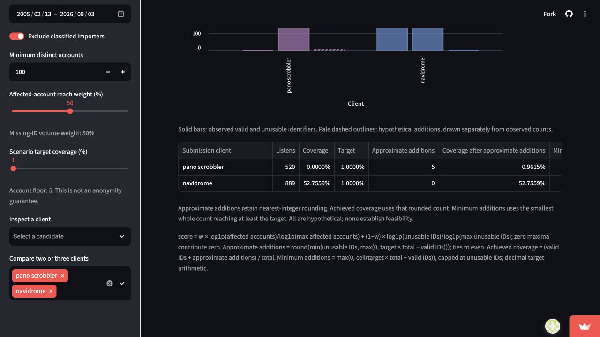
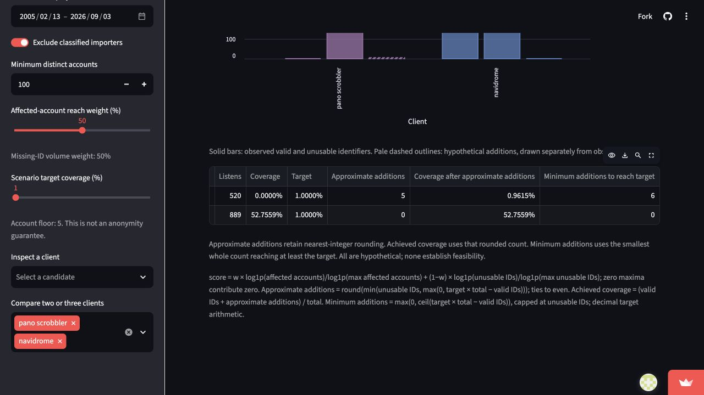
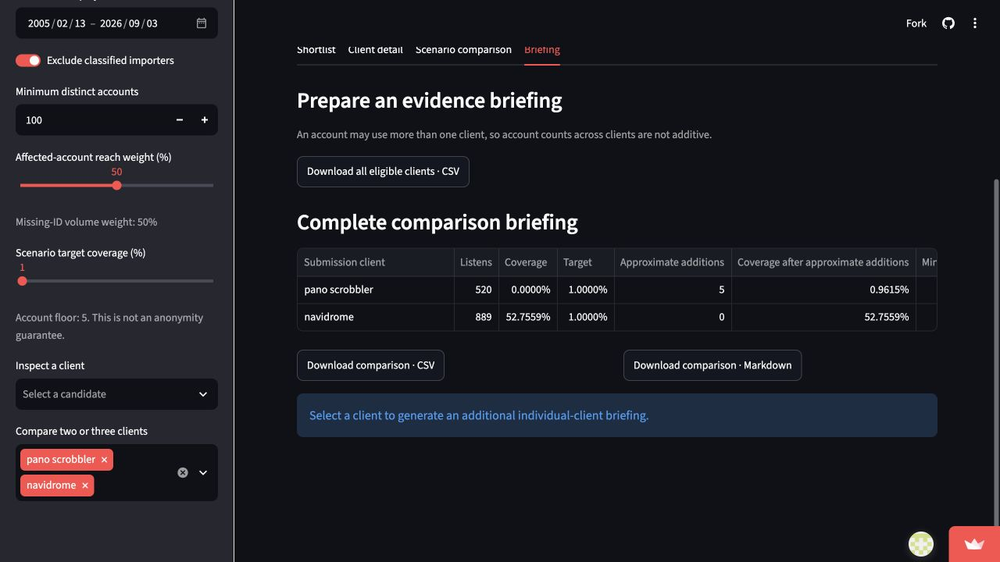
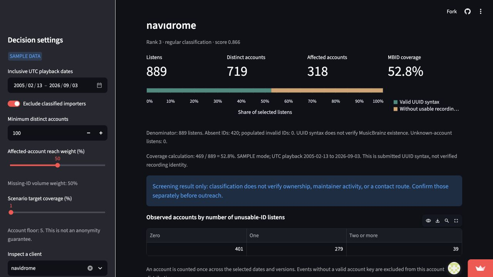
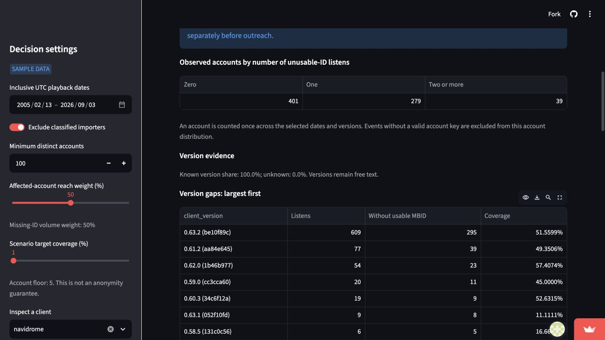
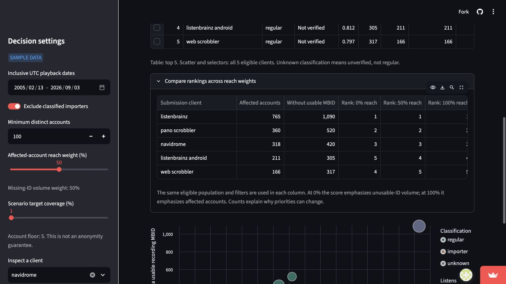
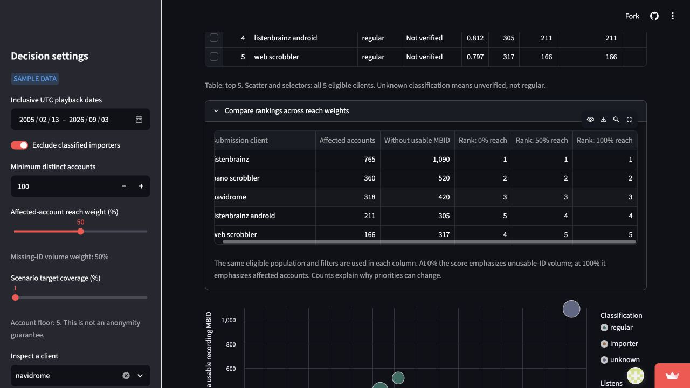
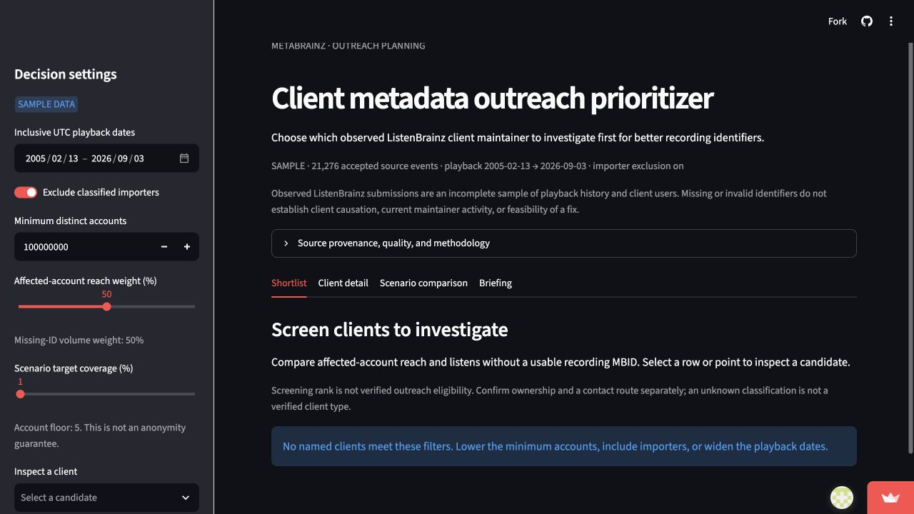

# Client Metadata Outreach Prioritizer — MVP validation

**Team T5 | November 9, 2026 | MVP validation**

This app helps a MetaBrainz outreach coordinator decide which ListenBrainz submission-client maintainers to investigate for a recording-identifier pilot. Missing identifiers can signal an opportunity to investigate; they do not prove who caused a gap or what intervention would work. The app organizes aggregate evidence for human review and sends no messages.

**Live app:** [Client Metadata Outreach Prioritizer](https://appapppy-mdilrzqijilc29whq52tc2.streamlit.app/). Deployment uses the `case-live-evidence` branch and root `streamlit_app.py`. The repository bundles the complete course sample of 21,276 events, with unused columns removed and account numbers consistently replaced. This is sampled submitted listening data, not all client users, a complete playback history, or the full raw dump. Counts, rates, eligibility, and rankings can differ from full-data results.

The five supplied individual cases appear in full in Section 2. Their original observations are historical evidence and may describe earlier app versions. The demo video is supplied separately by a teammate; its link must be included in the root README before hand-in.

## 1. Design

### Users, research and the decision

The intended user is a coordinator allocating limited investigation effort before proposing a pilot to client maintainers. This role and workflow are a design scenario, not an interview with an actual MetaBrainz employee. The goal is a defensible shortlist and a reproducible comparison, not the highest missing-ID percentage in isolation.

The MetaBrainz ListenBrainz project's [JSON Documentation](https://listenbrainz.readthedocs.io/en/latest/users/json.html) distinguishes the software submitting listens from the media player and distinguishes submitted identifiers from server-resolved mappings. These distinctions support a design judgment: show submitted-ID gaps without blaming a client or claiming that a syntactically valid identifier identifies the correct recording. The project's [Metadata API documentation](https://listenbrainz.readthedocs.io/en/latest/users/api/metadata.html) documents text-based recording lookup and manual mapping. Those are alternatives to investigate alongside client outreach, not validated remedies for this sample. The [course sampling methodology](https://github.com/USC-DSO-576-PS/dataset_listenbrainz/blob/main/sample/README.md) explains uniform random sampling and historical playback within a submission-day dump. Therefore the interface labels sample scope and uses playback dates rather than treating the dump date as the date of every listen.

Nora's case in Section 2 develops these sources and implications in a specific decision. No adoption study, maintainer interview or causal experiment was documented in these supplied cases. Current maintainer activity, willingness, costs and technical feasibility require evidence outside this dataset.

### Why the implemented features fit

| Feature | Decision served | Evidence or design reason |
|---|---|---|
| Shortlist and reach/volume weight | Identify candidates worth investigating | Distinct and affected accounts prevent event volume from being mistaken for people; sensitivity shows the value judgment in the weight. |
| Account floor and importer exclusion | Avoid basing a pilot on a tiny or inappropriate group | Exact classification is inspectable. Unknown types remain unverified; the floor is not an anonymity guarantee. |
| Absent/invalid-ID breakdown | Distinguish kinds of submitted-ID gaps | Different problems may need different investigation; neither category establishes client causation. |
| Client version and weekly evidence | Inspect concentration and observation scope | Unknown versions are disclosed. Unavailable weeks remain gaps, and edge weeks are marked partial. |
| Three scenario measures | Distinguish an approximate count from a threshold | Pano's 1% case requires 5 approximate additions but 6 minimum additions. Achieved coverage makes that mismatch visible. |
| Complete comparison plus individual briefing | Share a reproducible recommendation | All selected candidates and common settings travel together; users can still export one inspected client. |
| Portable sample and locked environment | Make the app usable by reviewers | A fresh environment and deployment need no sibling dataset folder or raw archive. |

The score uses affected-account reach and unusable-ID volume after logarithmic normalization within the complete eligible population. Its explicit weight is a user preference, not a learned probability. The app deliberately does not predict pilot impact, infer maintainer activity, verify every UUID against MusicBrainz, send outreach, or expose event-level downloads. Those actions need additional evidence or authority. The deployed sample supports interaction and exact sample counts at modest size; it does not justify population market shares or current install-base estimates.

Earlier design notes proposed DuckDB and percentile ranking. The implemented app uses Arrow/Parquet batches, exact account sets with a spill path, and the explicit logarithmic score in Section 3. This validation describes the actual source and deployed behavior, not those earlier proposals.

### Work beyond the starting build

The existing case identified CR-03 (threshold interpretation) and CR-04 (incomplete comparison export). The MVP preserves the original nearest-rounded measure and adds achieved coverage and minimum-to-reach counts. It adds complete CSV and Markdown comparison exports, while preserving individual-client exports. CR-02 adds absent/invalid columns to the shortlist. Version-gap ranking and contextual coverage address CR-05/06; all-client sensitivity and the account-distribution view address CR-07/08. The shortlist now labels its outreach status as unverified, addressing CR-09 without claiming an ownership verification that the data do not contain. The public sample launcher, portable run instructions, project dependency lock and redeployment-cache repair address reproducibility. These changes have dedicated regression checks and new live evidence, rather than being credited solely from a feature list.

## 2. Cases

### Case coverage

The five supplied individual cases cover different people and decisions. They include a MetaBrainz screening analyst, an outreach coordinator comparing candidates, a Navidrome version investigator, a Pano maintainer making a support decision, and a coordinator verifying an unknown client label. Together they include difficult cases: a low target that exposes rounding, changing ranks under different priorities, version traffic that does not measure support burden, and a high-ranked label with unverified ownership. All five supplied PDFs are preserved as submitted; Rachel's PDF does not identify an author, so this document does not infer one.

| Supplied case | Person and decision | Evidence and limitation |
|---|---|---|
| Tinyu: Nora | Whether the two-client comparison supports a pilot recommendation | Live Pano/Navidrome evidence, 1% threshold and complete-briefing concern; does not predict impact. |
| Leyna: Morgan | Whether Pano version traffic justifies keeping compatibility support | Live version evidence and official release/issue context; sample listens are not installations or support requests. |
| Zhongze: Alex | Which Navidrome version to investigate first | Live version counts and coverage, with official Navidrome/ListenBrainz context; a truncated version label is not a verified release identity. |
| Gigi: Ana | Which client merits the first diagnostic review under different weights | Live rank comparisons and documented sources; ranking stability at three weights is not a promise of causality or future stability. |
| Supplied Rachel case | Whether to add the unknown `listenbrainz` label to an outreach list | Live unknown classification and external documentation; a top score does not establish ownership or eligibility. |

The source index below supplies clickable links for the preserved Rachel and Zhongze PDFs, whose original pages show URLs but do not contain clickable link annotations. It also points readers directly to the principal sources in the other cases:

- ListenBrainz, [JSON documentation](https://listenbrainz.readthedocs.io/en/latest/users/json.html): client-submitted metadata, client/version fields, and server-resolved mappings.
- ListenBrainz, [Core API](https://listenbrainz.readthedocs.io/en/latest/users/api/core.html): listen submissions; relevant to Rachel's eligibility and submission-context decision.
- Navidrome, [scrobbling documentation](https://www.navidrome.org/docs/usage/features/scrobbling/): ListenBrainz integration; relevant to Alex's version investigation.
- Pano Scrobbler, [releases](https://github.com/kawaiiDango/pano-scrobbler/releases) and [historical issue 488](https://github.com/kawaiiDango/pano-scrobbler/issues/488): release context and an example of a version-specific user report for Morgan's support decision.
- MusicBrainz, [MusicBrainz Identifier](https://musicbrainz.org/doc/MusicBrainz_Identifier): identifiers distinguish database entities, relevant to Ana's diagnosis.
- ListenBrainz, [Metadata API](https://listenbrainz.readthedocs.io/en/latest/users/api/metadata.html): lookup and manual-mapping alternatives, relevant to Nora's comparison.

Each original PDF follows in full, including its source information and genuine live-app screenshots. The original screenshot values and change-request statuses document the app as observed on November 7–8; the subsequent MVP changes are summarized after the cases. A case may propose an investigation without asserting that the software caused a gap or that a maintainer has been contacted.

<!-- INSERT_FIVE_CASE_PDFS -->

### Updated live outcome for Nora

With sample mode, UTC playback dates 2005-02-13 to 2026-09-03, importer exclusion on, minimum accounts 100, reach weight 50%, Pano and Navidrome selected, and target 1%, the repaired comparison reports Pano's approximate additions as 5, achieved coverage about 0.9615%, and minimum additions as 6. Navidrome already exceeds 1%, so both addition measures are zero. The complete comparison briefing now contains both clients even with no inspected client selected. The downloaded live CSV was opened and independently inspected: it contained exactly two client rows, the 1% target, sample mode, playback dates, 5 and 0 approximate additions, 6 and 0 minimum additions, and no account identifier column. It also preserves the common filters. It contains aggregate results rather than account identifiers.

The recommendation after repair is narrower and more useful: the app can document the arithmetic and a two-client comparison, but Nora must still investigate metadata pathways and maintainer feasibility before preferring an intervention. A minimum hypothetical count is not an estimate of a maintainer's impact. The fixes improve the briefing without turning the scenario into causal evidence.

### Updated outcomes from the other cases

Alex can inspect the new version-gap table sorted by unusable-ID count and see the valid-ID numerator, denominator, computed coverage and sample/date scope together. Morgan can use the same reported-version evidence as an investigation lead, while still consulting actual support requests, release history and operating-system evidence before making a support decision. Ana can compare all eligible client ranks at 0%, 50% and 100% reach weight beside their affected-account and unusable-event counts. Independent counting reproduces the Android/Web reversal in her case. Rachel sees that the list is a screening rank and that outreach status is **Not verified** for every label: the dataset contains no verified ownership directory. No row is labeled outreach-ready merely because it is classified regular.

The new account-distribution view directly addresses CR-08. For Navidrome, an independent CSV grouping yields 401 observed accounts with zero unusable-ID listens, 279 with one and 39 with two or more. These sum to 719 distinct accounts; 279 + 39 = 318 affected accounts. This does not represent the full client user population. The aggregate is computed once per account across the selected date range and versions, and the temporary account keys are not displayed or exported.

### Additional workflow checks

The default screen opens with 5 eligible clients and no preselected client. Raising the account minimum to an extreme value returns an explanatory empty result and clears stale selections. Restoring the minimum recovers the shortlist. A two-client briefing can be generated without selecting an inspected client. Source scope, unknown classification and hypothetical-scenario cautions remain visible. These checks concern workflow robustness; they do not substitute for the missing member cases.

## 3. Numbers

### Definitions and counting population

One source row is a submitted listen. Preparation groups accepted events by UTC playback date, normalized submission client, version, internal account key and classification. One prepared row is therefore a group of events, not one unique person. Account identifiers remain private internal keys; public outputs contain only aggregate counts.

| Measure | Definition and units | Correctness condition |
|---|---|---|
| Total listens | Accepted event count in selected playback dates and filters | Matches direct source counting; valid + absent + invalid equals total. |
| Submitted-MBID coverage | Syntactically valid recording-UUID events / all selected events | Same denominator as total; not an identity/existence check. |
| Distinct accounts | Unique valid account keys across the entire selected client/date set | A repeated account counts once per group, not once per day or version. |
| Affected accounts | Unique valid accounts with at least one absent/invalid-ID event | At most distinct accounts; counts across clients are not additive. |
| Unusable-ID volume | Absent plus populated-invalid submitted recording IDs | Complements syntactically valid events; does not measure missing server mappings. |
| Score | w log(1+affected)/log(1+max affected) + (1-w) log(1+unusable)/log(1+max unusable) | Maxima use all eligible clients; a zero maximum contributes zero; sort by score, gap volume, then name. |
| Approximate additions | Nearest integer to min(unusable, max(0, target × total - valid)); ties to even | Preserves the documented original scenario; may fall below the target. |
| Achieved coverage | (valid + approximate additions) / total | Describes the rounded hypothetical count, not observed improvement. |
| Minimum additions | Smallest nonnegative integer reaching at least target coverage, capped at unusable events | Exact decimal target arithmetic avoids a false extra addition at integer boundaries. |

A client must be named and meet the chosen distinct-account threshold after filters. Importer exclusion removes exactly classified importer events; unknown labels remain unverified. Invalid account values contribute listens but no reach. Versions inherit parent eligibility; their account counts must not be added across versions to recover client reach.

### Independent audit and measured results

Run `uv run python scripts/validate_mvp.py` from the repository root. This audit independently reads the portable CSV using Python counters and sets, rather than the production adapters, groupings or rank function. It compares the app against those direct counters. Rank expectations use a separately written natural-log calculation; scenario thresholds use exact fractions and an exhaustive integer search. The report is saved in `evidence/mvp-numbers.json`.

| Source sample measure — all events, before eligibility filters | Independent result |
|---|---:|
| Events | 21,276 |
| Syntactically valid recording IDs | 654 |
| Absent IDs | 20,622 |
| Populated-invalid IDs | 0 |
| Distinct accounts | 4,060 |
| Affected accounts | 3,546 |
| Submitted-ID coverage | 3.073886% |

The default eligible-client population is different: 5 clients, 3,121 observed listens and 2,652 unusable-ID events. Do not compare its coverage denominator with the whole-source percentage above. The precise Pano/Navidrome values and the independent 1% calculation appear in the included case. The sample-source SHA-256 is `ac66335410c79c991c3b9609bbe0829789399be056652626119a5497bc84f0ee`.

| Independent comparison | Scope | Result |
|---|---|---|
| Client metrics and rank | Default filters, 5 eligible clients | PASS |
| Account distribution and version gaps | All 5 default eligible clients, including Navidrome 401 / 279 / 39 | PASS |
| All-client ranking comparison | 0%, 50%, and 100% reach; independent score ordering | PASS |
| Client metrics and rank | Importers included, minimum accounts 5, 27 eligible clients | PASS |
| Client metrics and rank | Single playback day 2026-09-03, 5 eligible clients | PASS |
| Empty threshold | Minimum accounts 100,000,000, 0 eligible clients | PASS |
| Version and measured-week metrics | Every default eligible client | PASS |
| Scenario counts and threshold minimality | Every default eligible client at 1%, 75%, 100% | PASS |

Portable-data parity was also checked against the original course sample: every event and measurement field is retained, with a one-to-one account replacement. No inverse lookup is packaged. The source identifier transformation changes source/preparation fingerprints but does not change equality-based counts.

The original live table displayed a 75% target as 70% because percentage precision was too coarse; the table formatting was corrected. Nora's historical screenshot shows Navidrome coverage as 52.7%, while exact counts give 469/889 = 52.7559%; the current table uses finer precision. These are display precision issues, not unexplained differences in event totals. Full-data figures and historical timing claims from earlier build reports are not presented as newly measured public-app results.

## 4. Tests

### What the suite protects

The suite uses hand-checkable fixtures, public-sample UI flows, independent audits and a simulated deployment update. The final clean-environment run is recorded in `evidence/test-summary.json`: **31 passed, 1 skipped, 0 failures**. It used Python 3.14.7 and the new `uv.lock` environment. The skipped integration test requires a separately prepared full dataset; the deployed MVP uses the bundled sample. Full-data deployment and arbitrary concurrency are not claimed.

| Risk or property | Test evidence | Why it matters |
|---|---|---|
| Wrong rows, units or date boundaries | January fixture; single-day and cross-month checks; raw/CSV adapter parity | A correct-looking chart can otherwise answer the wrong date/population question. |
| Double-counted reach | Shared accounts across clients/versions; forced spill equals in-memory results | Event totals can be added, but distinct people cannot be recovered by summing subgroup counts. |
| Reconciliation and bad inputs | Missing/invalid ID split; malformed JSON/timestamps; unsupported schema; duplicate inputs | Defective inputs must be counted or rejected explicitly. |
| Cache validity and interrupted preparation | Changed input/rule checks; failed write retains old completed cache | Reusing stale or half-written data can silently change decisions. |
| Ranking and scenario boundaries | Zero maxima, ties, invalid targets; exact fixture counts | Rankings must stay deterministic and estimates remain bounded. |
| Honest milestone interpretation | New exact-fraction regression: 1%, 7%, 50%, 75%, 100% on multiple totals; one fewer addition cannot reach the target | Protects the difference between an approximation and a threshold, including decimal boundaries. |
| Account distribution and all-client sensitivity | New fixture checks plus an independent per-account CSV grouping, and a live-sample UI check for the 401 / 279 / 39 split and Android/Web rank swap | The observed reach distribution and rank changes must be exact and understandable. |
| Complete and private exports | New two-client CSV/Markdown test; source/filter fields; injected private sentinel discarded | The exported evidence must support the comparison without carrying internal identifiers. |
| Usable comparison workflow | New two-client briefing test with no inspected client; individual-client briefing retained | A user should not lose the comparison when preparing a recommendation. |
| Deployment update recovery | New isolated launcher test changes the source timestamp and reruns | A repository refresh must trigger valid preparation rather than leave the public app in an input-changed error state. |
| UI edge states | Real bundled sample; extreme account minimum; empty and selection states; no raw-data reads during control changes | Common interactions must work from the packaged repository. |

The seven MVP-specific regression tests are in `outreach-app/tests/test_mvp_regressions.py`. The account-distribution audit and all-client ranking cross-check are in `scripts/validate_team_findings.py`, with aggregate results in `evidence/team-findings.json`. Two older UI tests were repaired to prepare and use the bundled sample rather than depending on a neighboring dataset/cache; that fixture repair is distinguished from new test coverage. Existing Module 10 gap tests were retained. Historical starting-build tests are described in `BUILD_FINDINGS.md`; they are not credited as new MVP work.

### Reproduce and interpret the evidence

From the repository root, run `uv sync --locked`, then `uv run python scripts/validate_mvp.py` and `uv run python scripts/validate_team_findings.py`. For the test suite, change into `outreach-app` and run `uv run python -m pytest -q`. The ZIP excludes `.venv`, private prepared data, secrets, raw archives and caches. A recipient can recreate the environment and sample preparation from committed files.

The live checks and unit/integration results establish the tested sample behavior and key arithmetic; they do not establish current maintainer activity, UUID semantic accuracy, causal effects, arbitrary data-size limits, Windows execution or high-concurrency performance. Before submission, add the completed unlisted demo video link, open both links without sign-in, and rebuild the ZIP from the final reviewed commit. Only the final submitted package should be graded as the completed MVP.
